# xiaohey

一个留在本机的 Windows 桌面编码代理。Electron 外壳 + 本地 Runtime，会话、上下文、工具执行、检查点全部落在这台机器上。

- **Runtime**：一轮对话是一个有界的循环（组装上下文 → 调模型 → 执行工具 → 打检查点），每一步的意图先写日志再执行。
- **上下文与记忆**：契约原文、计划、记忆、指代消解结果外置到磁盘，每轮重新读取；上下文超预算时折叠成摘要，而不是让它自己「记得」。
- **工具**：10 个工具，描述里写清 `Use when / Do NOT use when`；写操作带租约、幂等键、意图日志和检查点。
- **设置是一个独立页面**：左侧导航（模型 / 外观 / 使用统计 / 关于），模型页里是已添加模型的清单与「添加模型」；模型配置只在这里改。
- **三栏界面**：工作区历史 / 工作区 / 文档显示区（文件、原文与改动、记忆、检查点）。

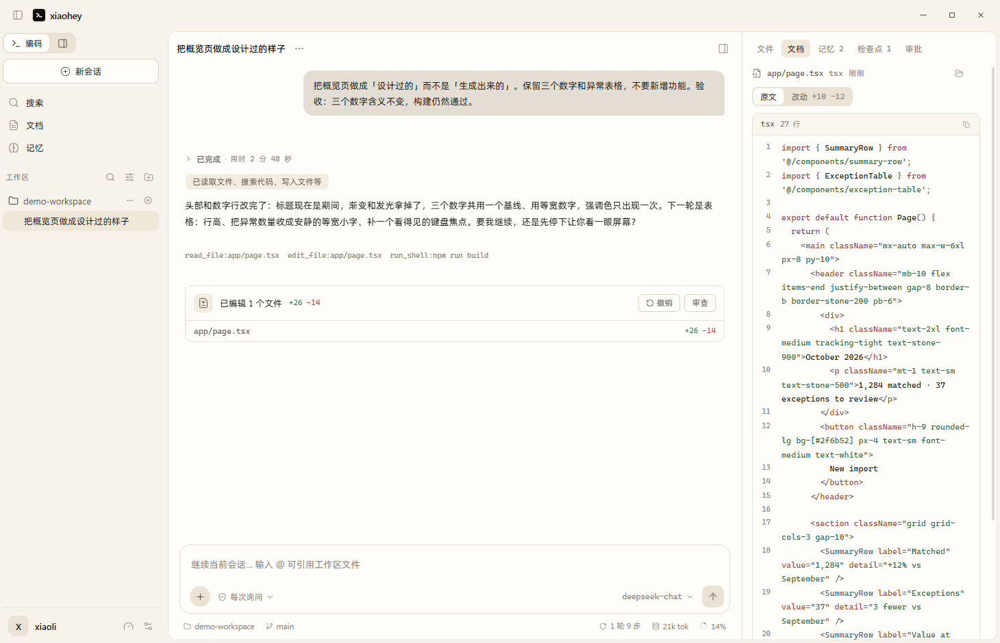

## 快速开始

```bash
npm install          # 首次安装；Electron 二进制若没下来，见下方「安装备注」
npm run dev          # Vite + esbuild 热更新窗口
npm run build        # 产物：dist/main、dist/preload、dist/renderer
npm start            # 跑已构建的版本
npm test             # Runtime 自检，36 项，不需要网络和模型
npm run shot         # 用演示数据启动并截图到 shots/
```

Node 22+。开发时窗口打开开发者工具；设置里填入任意 OpenAI 兼容端点即可（DeepSeek、OpenAI、本地 llama.cpp、内部网关都行）。

## 打包

```bash
npm run dist     # tsc 类型检查另跑：npm run typecheck && npm test
```

产物在 `release/`：

| 文件 | 用途 |
|---|---|
| `xiaohey-0.1.0-setup.exe` | NSIS 安装包，约 118 MB，**按用户安装**，不需要管理员 |
| `xiaohey-0.1.0-portable.exe` | 免安装单文件，约 107 MB，双击即用 |
| `win-unpacked/` | 解包目录，便于调试 |

- 安装位置 `%LOCALAPPDATA%\Programs\xiaohey`，同时创建开始菜单与桌面快捷方式，卸载用目录里的 `Uninstall xiaohey.exe`。
- 应用数据在 `%APPDATA%\xiaohey`（`settings.json`、`threads/`、`snapshots/`、`leases.json`）。
- 默认工作区是 `文档\xiaohey`；用 `xiaohey.exe --workspace=D:\code\some-repo` 指定别的目录。
- 图标在 `build/icon.ico`（由 `build/icon.png` 生成），品牌色 `#4b6f5a`。
- **没有代码签名证书**：首次运行 Windows 会弹 SmartScreen，点「更多信息 → 仍要运行」即可；企业分发建议自签或买证书后配 `CSC_LINK`。

**安装备注**：若 `node_modules/electron/dist` 为空，说明安装脚本被策略拦了，手动补一次二进制即可：

```bash
set ELECTRON_MIRROR=https://npmmirror.com/mirrors/electron/
node node_modules/electron/install.js
```

## 界面

按本地 Qoder CN 的窗口结构复刻，三层：**画布 → 圆角工作区 → 三栏内容**。标题栏左边是墨色方块 + `| <` 眼睛的品牌标 + `xiaohey`，不再重复显示工作区名（工作区在侧栏里）。

1. 最底层是整窗画布 `#f6f6f6`，无边框窗口（`titleBarStyle: hidden` + 原生按钮覆盖层），顶部 52px 是可拖动的标题条：侧栏开关、品牌、工作区名。
2. 画布上浮着一块**白色圆角工作区**（1px `#e6e6e6` 边框、12px 圆角），四周留 4px 边距（上下 2px）；侧栏不在工作区里，直接坐在画布上。
3. 工作区内部才分成会话流与文档两栏，中间一条细线。

| | 区域 | 内容 |
|---|---|---|
| 画布左 | 工作区历史 | 模式切换（编码 / 文档）；下面是整宽的「⊕ 新会话」按钮（白底细边，内容居中），再往下是搜索 / 文档 / 记忆三行导航；`工作区` 分组下面是一行工作区（文件夹图标 + 名字），再往下是这个工作区的会话列表——**会话标题与工作区名左对齐**、卡片占满整行，行尾是相对时间，hover 出 `···`（重命名 / 删除，删除要二次确认）；**没有「最近对话」分组**，没有会话时整块只显示「暂无任务数据 :)」；**左下角是灰色头像 + 用户名**，右侧是「用量」仪表与「设置」齿轮，点头像弹出「设置 / 切换外观 / 退出登录」 |
| 工作区内左 | 工作区 | 会话流：用户消息、任务契约、计划、工具卡片（可展开输出）、改动卡片（逐文件 +/− 与撤销/审查）、审批、上下文折叠；输入框是 16px 圆角、浅描边、**比正文列更宽**的大框，左侧圆形「+」直接开文件面板，带批准方式（每次询问 / 自动审批 / 完全访问）与模型切换（只列已添加的模型，点一下即切换），运行中发送键就地变成中止；输入框下侧一行元信息：左侧轮次 / 步数、累计 token、上下文占用环，右侧工作区名与当前 git 分支（不是仓库时只显示工作区） |
| 工作区内右 | 文档显示区 | 文件浏览 · 文档 · 记忆（含冲突标记） · 检查点（整步回退）；**文档按类型渲染**——Markdown 排成文档（标题/列表/表格/围栏代码块高亮）、代码带语法高亮与行号、图片内联显示、二进制给提示；`原文 / 改动` 可切换；**和对话区之间有一条可拖动的分隔条**——左右拖动改占比、双击恢复默认、方向键微调、宽度记住 |


新会话还没有内容时，中间不是一段说明文字，而是一张**使用频率热点图**：最近 52 周、按天统计消息与工具调用的次数，分五档深浅；下面是输入提示。

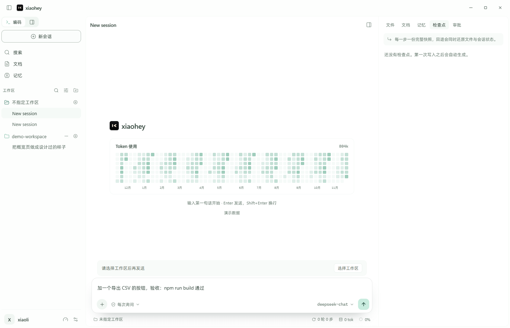

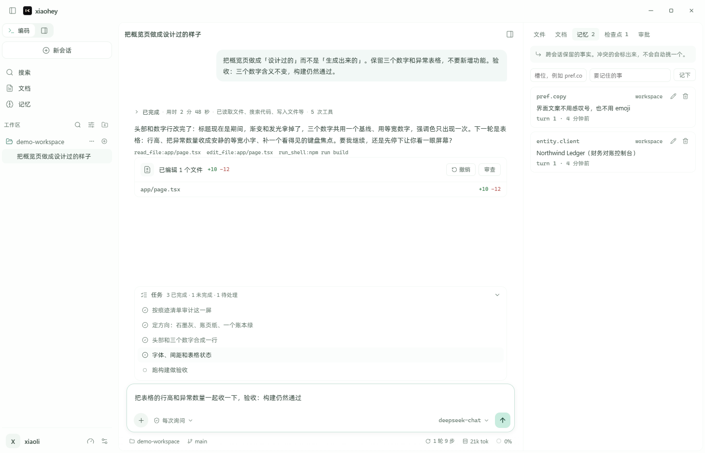

批准方式在输入框左下角切换，三档，选择会写进 `settings.json`：

| 档位 | 行为 |
|---|---|
| 每次询问 | 每条命令执行前都停一次，「允许一次 / 本会话允许 / 拒绝」 |
| 自动审批 | 只有匹配到风险规则（递归删除、`git push --force`、全局安装、下载后直接执行、改注册表…）才停 |
| 完全访问 | 不再询问，命令直接跑；日志、意图对账、检查点照旧 |

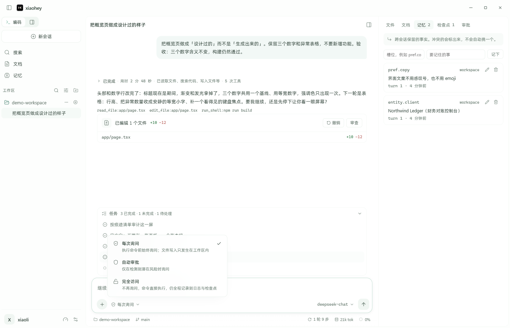

模型切换在同一行右侧，下拉里**只有设置里已添加的模型**，点一下就切过去并记住，不会弹出配置：

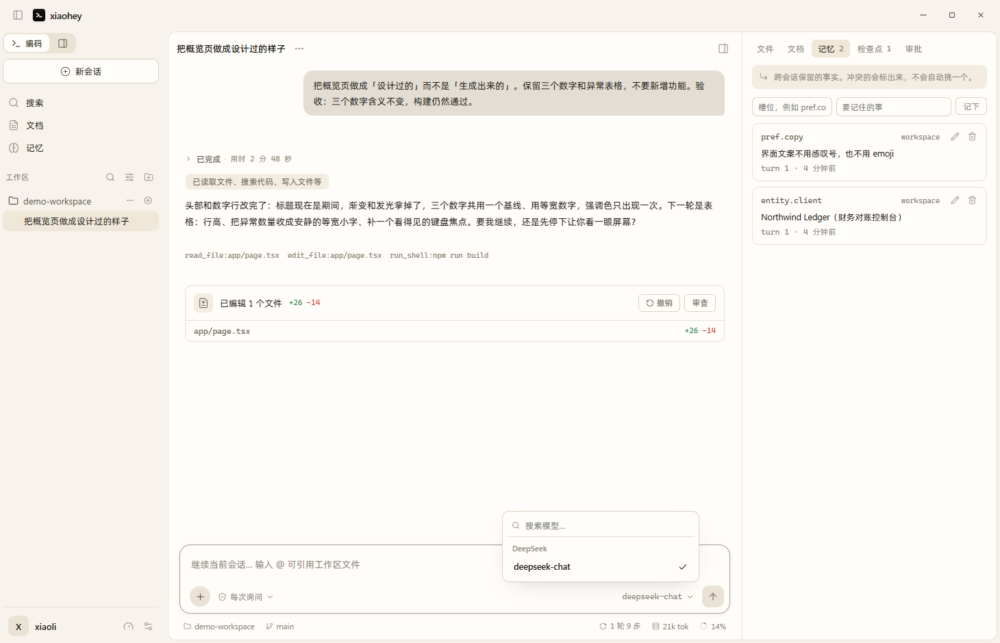

模型的新增走「供应商 → 类型 → 模型 → API Key」：供应商里分「推荐 / 更多 / 自定义」，每家带自己的品牌色和「获取 API Key ↗」入口，类型（Token plan / 按量付费）右侧直接给「购买 Token Plan ↗」链接；**模型列表不是写死的**，打开列表时用你的 Key 请求该供应商的 `GET /models`，拉回来的就是这把 Key 真正能调的模型，可以多选、全选、按名字筛选；拉取失败会显示原因并可「手动填模型名」兜底。底部只有一个「校验并添加模型」：先真的发一次请求校验连通性，通过才写入，失败则显示错误并给「仍然添加」的出口。编辑已有模型才展开接口地址、上下文窗口、输出上限、温度。

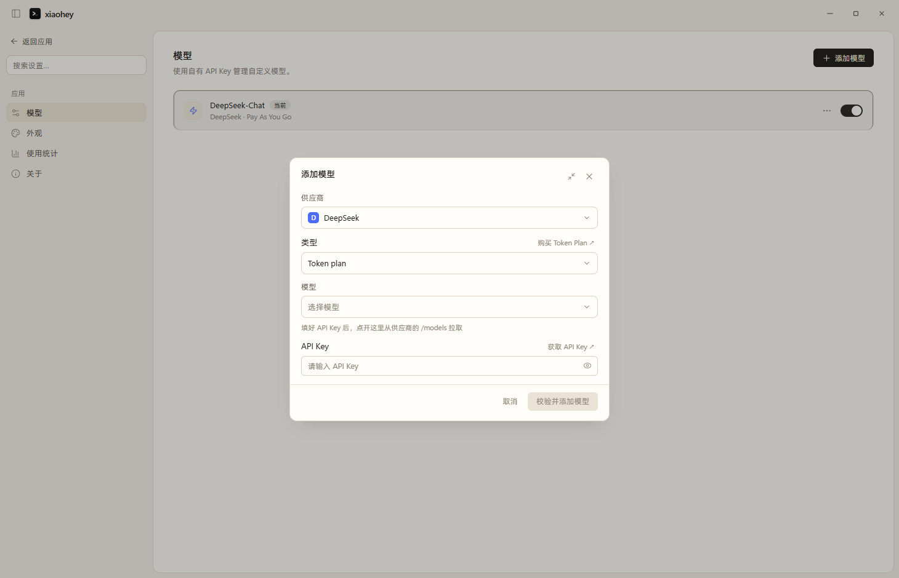

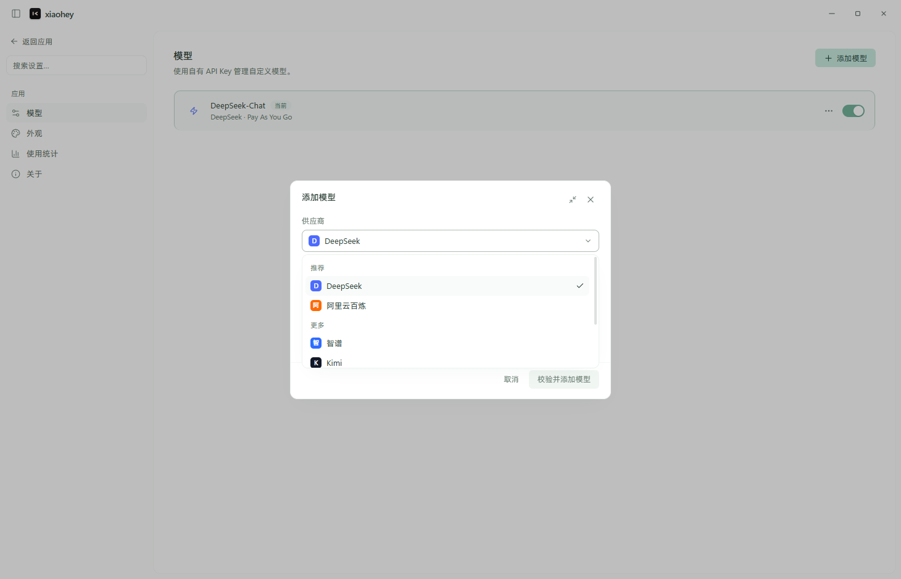

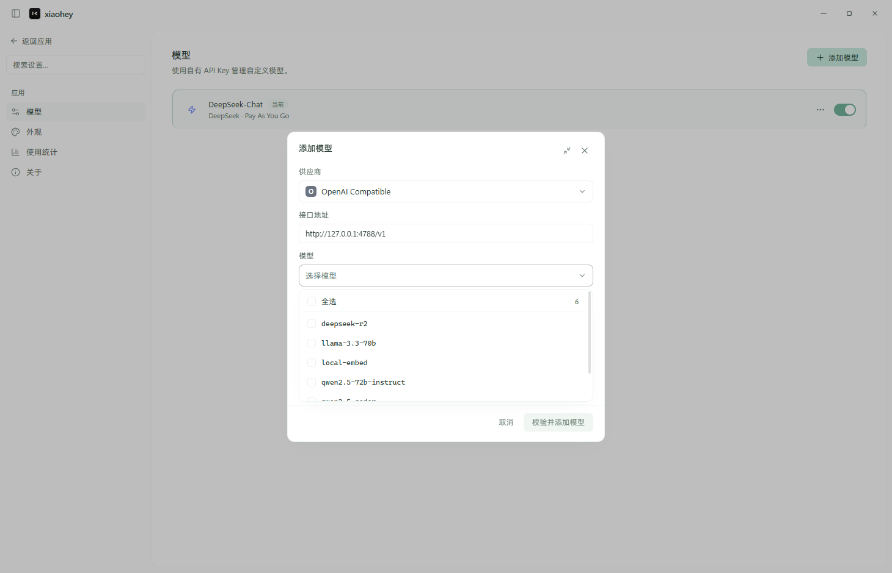

左下角的头像用的是本机 Windows 账户名（首字母做头像），点开是设置入口：

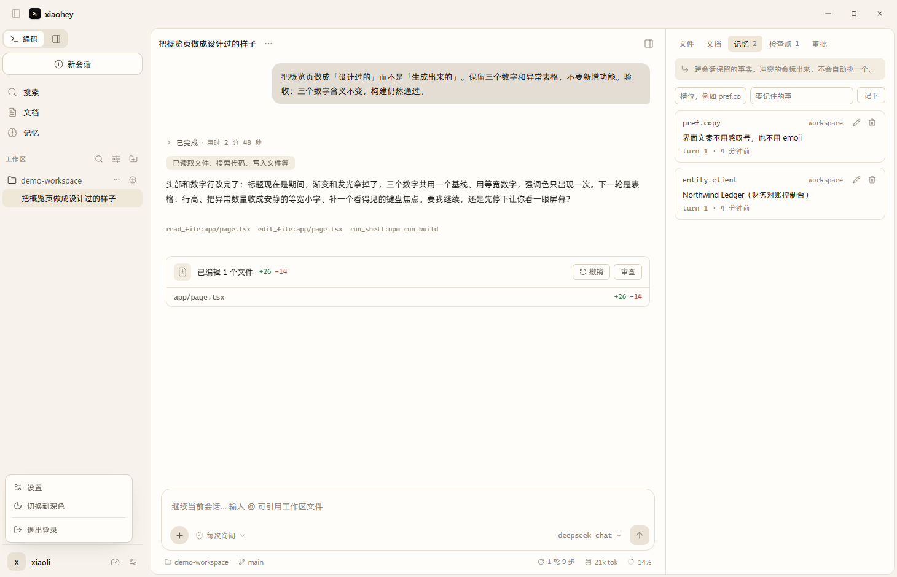

「设置」里只有模型：接口地址、API Key、模型名、上下文窗口、输出上限、温度，带一次真实连通性测试。「退出登录」需要二次确认——本机没有账号体系，它清除的是唯一一份凭据，即 `settings.json` 里保存的 API Key；会话、检查点、记忆都保留。

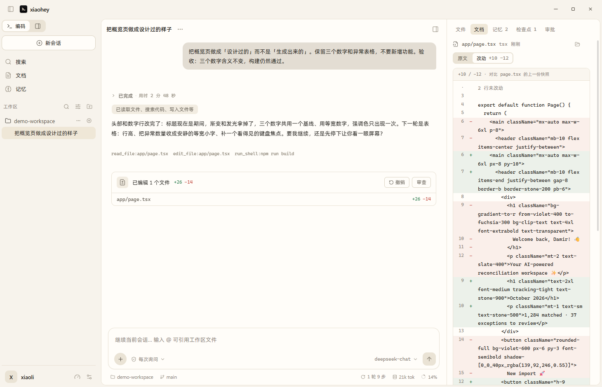

| 记忆（冲突会标出来） | 检查点（整步回退） |
|---|---|
| 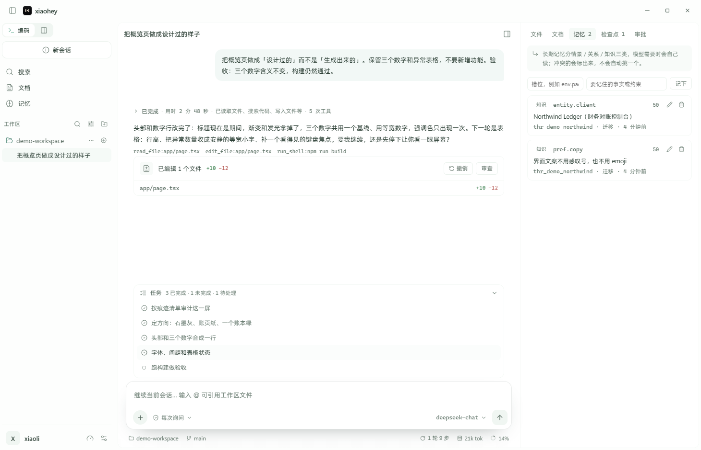 | 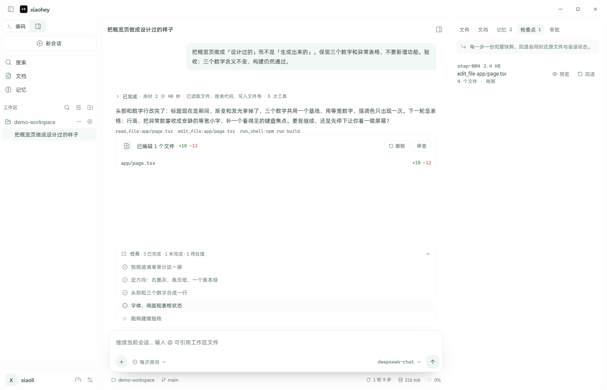 |

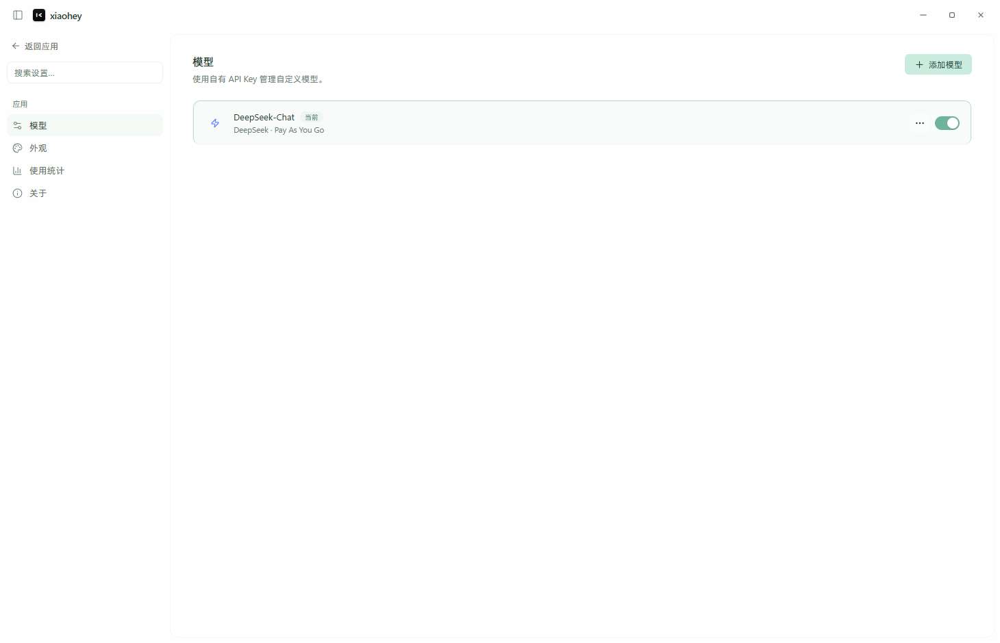

配色是从正在运行的 Qoder CN 窗口上取色得到的：画布 `#f6f6f6`、工作区 `#ffffff`、边框 `#e6e6e6`、选中行 `#e9e9e9`；正文 `#1e1f1e`、次级 `#5f625f`、说明 `#949894`；唯一的强调色是偏灰的鼠尾草绿 `#4b6f5a`（发送键、选中图标、进度）。改动里的 `+`/`−` 用 `#2e7d4f` / `#c0453a`，是界面上唯一允许的第二组颜色。

**字体**：中文用 **阿里巴巴普惠体 3.0**（Alibaba PuHuiTi 3.0），打包了 400 / 500 / 600 三个权重的 woff2（按 unicode-range 切片，约 15 MB，随应用分发）；拉丁字母与数字优先走系统 Segoe UI，中文回落到普惠体。字体授权与来源见 [src/renderer/assets/fonts/LICENSE.md](src/renderer/assets/fonts/LICENSE.md)。

暗色是同一套结构：画布 `#141414`、工作区 `#1b1b1b`、边框 `#2b2b2b`、强调色 `#8fb59c`。左下角的太阳/月亮切换，选择会记住；首启是浅色。

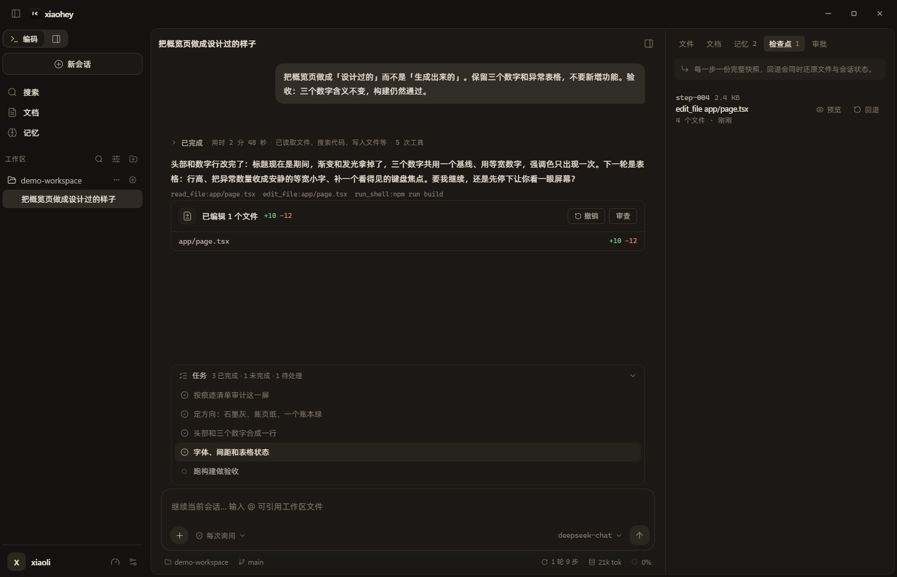

## 代码地图

```
src/main/                 主进程 = app server
  index.ts                窗口、IPC、演示数据
  server.ts               请求路由（thread/turn/fs/settings/snapshot）
  store.ts                会话与状态持久化（JSON，原子写）
  demo.ts                 演示工作区与会话
  audit.ts                对账：从磁盘事实推导进度
  runtime/
    agent.ts              一轮对话的循环：上下文 → 模型 → 工具 → 检查点
    llm.ts                OpenAI 兼容流式客户端（工具调用、错误分类）
    context.ts            提示组装、预算、折叠、证据审计
    tools.ts              10 个工具 + 路由描述
    toolerrors.ts         L1/L2/L3 参数与领域错误、修复提示、重试预算
    locks.ts              租约（TTL + 指纹），崩溃后接管
    journal.ts            意图/提交日志与对账
    checkpoint.ts         影子快照树、校验、整步回退
    contract.ts           任务契约与漂移拦截
    memory.ts             记忆槽位与冲突分类
    resolve.ts            实体/相对时间/事件锚点
src/preload/              contextBridge（只有 request + onEvent）
src/renderer/             React 界面
src/shared/types.ts       协议类型（renderer 与 main 共用）
tests/selftest.ts         22 项 Runtime 自检
docs/design.md            方案：agent.md 八个问题怎么解
```

## 与 Codex 的关系

主进程充当 app server、渲染进程是它的一个客户端；thread → turn → item 的对象模型、`item/started → delta → item/completed` 的推进方式、审批作为服务端请求卡住本轮、上下文折叠替换模型可见历史、会话 JSONL 可恢复——这些都是照着 Codex 的做法来的。没有照搬的部分：WebSocket/stdio 传输层、MCP 与动态工具、子代理图、SQLite + rollout 双存储。见 [docs/design.md](docs/design.md#参考-codex-的部分)。

## 图标

图标是一块高级黑的圆角方片，上面两只奶白色的眼睛：左边 `|`、右边 `<`，粗圆头笔画，没有别的装饰。

- **动效**：待机是完整的 `| <`；悬停时左眼（竖条）变宽、右眼轻推、整块轻微上浮；按下时收窄一点（像被按下去）；闲置时每 3.6–6.2 秒左眼闪一下。wink / sleepy 两个状态留给后续。标题栏和首屏用同一个 `<BrandMark>`，`data-expression` 跟着状态变。
- **图标组**（`npm run icons` 可重新生成）：
  - `build/icon.ico`：16/32/48/64/128/256 六个尺寸，Windows 安装包与 exe 用它；
  - `build/icons/icon-16 … icon-512.png`：16/24/32/48/64/128/256/512 八档 PNG；
  - `build/icon.png`：512 主图；`src/renderer/public/icon.png`：窗口 favicon。
- 底色是带一点顶部光泽的纯黑渐变；深色主题下略微提亮、内描边更明显。笔画固定为奶白 `#f7ead9`，和图标文件完全一致。

## 回复渲染

- 助手的回复按 Markdown 渲染：行内代码（`C:\Users\…` 会变成代码块样式）、加粗、列表、围栏代码块、表格、引用、链接（外链走系统浏览器）。
- 我自己发的消息保持纯文本，输入里的反引号不会被“美化”，所见即所发。

- 回合进行中，输入框右下角的发送按钮会变成深绿色的**圆角方块停止键**（`停止生成`），点一下中止当前回合；结束后恢复成发送箭头。

- 输入框底栏：左边是**工作区**（文件夹图标 + 名字），点一下就在输入框上方弹出工作区选择器；右边是轮次/步数、token、上下文占用。
- 选择器会按空间自动向上/向下展开，不会被窗口底边裁掉。

## 主题：纸与墨

主题色取自应用图标（黑色方块 + 奶油色 `| <` 眼睛），不是另配一个品牌色：

| 角色 | 浅色 | 深色 |
| --- | --- | --- |
| 画布 / 面板 | `#f7f3ec` / `#fffdf9` | `#141210` / `#1b1815` |
| 主文字 / 次文字 | `#1c1a16` / `#5c564c` | `#efe8db` / `#b4ab9c` |
| 主操作（发送、撤销） | 墨黑 `#1f1c17`，奶油字 `#f7efdf` | 奶油 `#e8dcc4`，墨黑字 `#1b1712` |
| 选中 / 高亮 | 奶油 `#efe7d7` | `#2f2a23` |

- 中性色整体偏暖（纸），不出现彩色底；彩色只留给增删（绿/红）与警告（琥珀）。
- 主按钮与图标同源：黑底奶油字，深色模式下反转为奶油底墨字。

## 重启恢复

- 关闭或崩溃时还在跑的回合，下次启动会恢复成空闲：回合标记为已中断，头部显示「已中断」，并留下「上一轮已中断 / 应用已退出」的提示，不会一直转圈、也不会再显示「已完成」。
- 正常退出会先把运行中的回合收尾再写盘；异常退出则由启动时的恢复逻辑兜底。

## 复制

- 用户消息下方、以及**整块模型回复（含结果卡）的最下方**各有一个复制按钮，鼠标悬浮到对应区域才显示；点击后短暂变成对勾。
- 模型回复的复制按钮**只在整轮回复完全结束后出现**，运行中不提供。

## 磨砂玻璃

- 输入框停靠在一个悬浮的底栏里，半透明暖纸底 + 22px 背景模糊；消息从它下面滚过。
- 同一材质只用在**浮层**：工作区/策略/模型菜单、排队面板、「回到最新」按钮；正文卡片保持不透明，优先可读性。
- 深色主题同样生效（深色半透明），不叠加渐变、发光或彩色阴影。

## 单行状态

- 运行中的状态行固定一行：「正在执行 · 动作/命令 · 秒数」；命令再长也会在中间省略，不会把「正在执行」挤成两行。

## 回合结果卡

- 回合结束后，最终回答下方会留一张**结果卡**：`已编辑 N 个文件 +A −D`，逐行列出文件与增删行数。
- 卡片不随过程折叠消失；点文件名在文档区打开该文件的 diff，「审查」看第一个文件，「撤销」回退这次改动。

## 回合中的排队消息

- 回合进行中也能继续输入：回车一律**磁吸在输入框上方**形成排队列表（标题显示「N 条排队消息」，可折叠）。
- 当前回合结束后自动开启下一轮，按顺序把排队的消息发出去。
- 每条排队消息支持**编辑**（铅笔）、**删除**（垃圾桶）、**立即发送**（上箭头）——上箭头会立即中止当前回合并把它插进对话。

## 工作区与会话

- 会话行的 `···` 菜单：重命名、置顶/取消置顶、删除；**删除是一步完成**，不再弹二次确认。
- 顶部「新会话」创建的是**不指定工作区**的会话：此时输入框提示「请选择工作区…」，直接发送会提示「请选择工作区后再发送」并给出选择入口，不会误发。
- 选好目录后，工作区会**绑定到这个会话**（不新开、不丢上下文）；侧栏工作区名随之更新。
- 侧栏「工作区」标题右边三个按钮：**搜索会话**、**只看置顶**、**文件夹加号＝新建工作区**（系统目录选择框）。
- 工作区行右侧：`···` 打开工作区菜单，支持**重命名**（直接改文件夹名，相关会话路径同步更新）、**在文件夹显示**、**删除工作区**（从列表移除，不删文件）；`⊕` 在当前工作区新建会话。
- 点工作区名打开选择器：搜索、本机、不指定工作区、最近工作区（当前打勾）、新建工作区、连接 SSH 主机（占位）。

## 对话导航

- 对话区右侧有一列紧凑的细横条，**在可视高度里垂直居中**，每一轮对话一条，间距 9px；轮次多时自动压缩间距，只有一轮时不显示。
- 正在读的那一轮最长（20px），并随滚动实时更新；鼠标悬停的那条次长（16px，不会盖过当前阅读条），颜色加深，左侧弹出卡片——标题是你那一轮说的话，下面是这轮回复的摘要（最多三行）。
- 点击整行：平滑滚动到那一轮的开头。
- 原生滚动条已隐藏（滚轮/触控板照旧），右侧只留这一列细条做导航。

## 问题澄清

- 模型拿不准时（范围、方案、偏好），会调用 `ask_user` 停下来问一句：输入框上方磁吸一张提问卡，列出 2–4 个选项，选项可以带一句说明。
- 直接点选项，或在卡片底部写下自己的答案。回答后**同一轮继续跑**，模型拿到的就是这个答案，不会另开一轮；卡片随后落回对话里，保留问题与你的回答。
- 提问期间会话状态显示「等待回答」，输入框右侧仍是停止键；点停止会把问题标成「已取消」并回到空闲。
- 问题会留在对话里：重启后仍能看到当时问了什么、选了哪一项；没来得及回答的显示为已取消。

## 工作区

- 点侧栏里的工作区名会弹出切换面板：顶部搜索框（名称或路径）、「本机」分组、「不指定工作区」、最近打开过的工作区（当前项打勾）；分隔线下面是 **＋ 新建工作区**（系统文件夹选择框，可在框里新建文件夹）和「连接 SSH 主机」（暂未支持，占位）。
- 选完会在那个文件夹里新建一个会话并切过去，最近工作区记进设置；之后的会话都落在当前工作区里。
- 工作区名后面的路径是这次会话的真实目录；每个会话都记住自己的 cwd。

## 版式

- 模型回复占满对话区宽度（只留 24px 内边距），不设行宽上限。
- 我发的话是右对齐气泡（最大 78% 宽，圆角 14px），不会横着铺满；回复是左对齐正文。
- 输入框和对话区同宽同起点，视线不用左右跳。
- 侧栏会话列表只显示标题（和运行/失败状态），不显示「刚刚」这类相对时间；工作区用普通文件夹图标；列表不会出现横向滚动条。
- 工作区宽度可以拖：侧栏和对话区之间有一条分隔条，拖动改宽度（200–420px），方向键微调，双击回默认，宽度会记住。

## 过程与操作

对话按「一轮」折叠成一段过程，和 Qoder 的做法一致：

- **一行状态**：正在跑的时候整个回合只占一行——「正在执行 · 运行命令 npm run build · 12 秒」；跑完折成「已完成 · 用时 2 分 48 秒」，下面一行灰色摘要（「已读取文件、搜索代码、写入文件等」），答案直接可见。点这一行才展开每一步。
- **展开后的操作行**：每个工具一行，中文动作 + 参数 + 耗时——「读取文件 app/page.tsx 41ms」「搜索文本 /gradient|glow/ 22ms」「执行命令 npm run build 8.4s」；每行开头是这一步自己的完成勾（跑的时候是转圈，失败是叹号），标题行不再打勾。点开看完整输出、失败原因和改到的文件。
- **思考行**：「思考中」在等待模型时出现，「已思考」带一行推理预览，点开看完整推理。
- **其它过程信息**：任务契约、计划、改动卡片（+N −M）、审批记录、上下文折叠都在这一层里。
- **任务清单**：模型用 `todo_write` 拆出 2 步以上时，输入框上方会磁吸一张任务卡，实时显示「已完成 / 进行中 / 待处理」和每一步的状态，可折叠；这一轮结束自动收起，历史计划仍留在过程层。
- **答案永远可见**：执行到最终结果后过程自动收起，只留答案和一行操作摘要；点状态行或摘要随时展开全部过程，回退这类系统通知到达时会自动展开。

## 交互细节

- **引用文件**：输入框左侧 `+` →「引用工作区文件…」，搜索后插入 `@path`；也可以把文档区的文件行直接拖进输入框，或从系统拖入 / 粘贴文件——会自动复制进 `uploads/` 并插入引用。发送时文件内容作为 `<referenced-files>` 块交给模型，气泡里只显示你打的字。
- **检查点**：每行可「预览」——列出回退会还原/删除的文件和行数，展开看逐行 diff，再「确认回退」；回退会先拍一份「回退前」快照，顶部给出「撤销这次回退」。
- **默认两栏**：打开工作区时文档渲染区是收起的，对话占满宽度；点标题栏右侧的方框（或 `Ctrl/Cmd+Shift+B`）展开，展开/收起的选择会记住。点开工具产出的文件时仍会自动展开。
- **会话置顶**：行菜单里的「置顶 / 取消置顶」，置顶的排在最前并带图钉。
- **批准方式**：三档在输入框里都是同一种中性样式，只换图标和文字——「完全访问」不再是红色警报，就是一个开锁图标。
- **模型**：输入框右下角显示具体模型 id（例如 `deepseek-flash`）。点开是按厂商分组的列表——「DeepSeek」下面是 deepseek-flash / deepseek-v4-pro，「MiMo」下面是 MiMo-V2.5…，当前模型打勾；顶部有「搜索模型…」，按模型名或厂商名过滤。编辑模型复用添加模型的面板：供应商 / 类型 / 模型三项锁定（只读，附「添加后不可更改」提示），只能改 API Key——留空沿用旧 Key；底部是「校验并保存」，先真实调用一次再落盘。
设置里是一张模型列表：每行一个厂商图标 + 模型名（`DeepSeek-V4-Pro`）+「厂商 · 计费方式」+ `···` 菜单（设为当前/编辑/删除）+ 开关；关掉开关的模型不出现在选择器里，当前模型被关掉会自动切到下一个可用的。
- **上传**：文档区「文件」页有上传按钮，落到 `uploads/` 并刷新列表。
- **复制与导出**：回复、提问、工具输出、文件内容、Markdown 代码块都有复制按钮；`···` 菜单里有「复制为 Markdown」和「导出 .md 到 exports/」。
- **失败重试**：会话失败后标题栏出现「重试上一轮」。
- **审批**：文档区「审批」页签列出每次审批与决定；审批卡上有「总是允许这条命令」，写进设置后同类命令不再询问。
- **记忆**：记忆页可新增、就地编辑、删除。
- **键盘**：`Ctrl/Cmd+N` 新会话、`Ctrl/Cmd+,` 设置、`Ctrl/Cmd+B` 收侧栏、`Ctrl/Cmd+Shift+B` 收文档区、`Esc` 中止本轮。
- **其它**：向上滚出现「回到最新」；文件列表可筛选/刷新，预览可「在资源管理器中显示」；窗口不在前台时回合结束发系统通知；没配模型时首屏有直达设置的按钮；同一时间只允许一个实例。

## 测试与质量

`npm test` 是运行时自测（36 项：记忆冲突、时间/实体解析、任务契约、WAL 对账、租约、工具错误分类、提问选项归一化、检查点回退、上下文折叠、审批策略、思考模型回放）。

界面与回合流程用真实 Electron + Playwright 跑，配一个本地假 OpenAI 兼容端点（HTTP/SSE）验证流式回复、工具调用、审批、写入与撤销。最近一次全量回归：**135 / 135** 项检查（含此前缺失交互的补齐：引用文件、复制/导出、重试、审批页、记忆编辑、快捷键、回到最新、会话置顶、回退预览与撤销、文件上传）。另外用真实的 DeepSeek Key 跑了一轮 8 场景联调（创建/修 bug/重构/只读分析/跑测试/越界拦截/多轮/审批），全部通过；期间发现并修复了「思考模型多步回合 400」和「契约护栏误伤读写」两个缺陷。完整清单、复现步骤和剩余缺口见 [docs/qa-report.md](docs/qa-report.md)。

**模型兼容性**：普通 OpenAI 兼容模型与思考型模型（先返回 `reasoning_content` 再返回正文，例如 DeepSeek reasoner / flash）都支持。思考模型要求把本轮每条助手消息的 `reasoning_content` 回传，否则第二步就会 400；客户端会记录并回放它，模型没产出 reasoning 的步骤用空串补齐，失败时还会自愈重试一次。

## 已知边界

- 单工作区、单窗口；并发来自多个会话，不是多窗口。
- 主题默认浅色（与 Qoder 截图一致），左下角可切暗色；两套主题共用一套结构与间距；设置页只放模型配置。
- 检查点是整棵树的拷贝（跳过 `node_modules`/`dist`/`.git`），大仓库会慢，适合中小项目。
- 折叠摘要用的是一次额外模型调用；模型不可用时退化为机械摘要，不阻塞本轮。
- `run_shell` 在 Windows 上走 `cmd.exe`，没有沙箱隔离；是否放行由审批决定。
